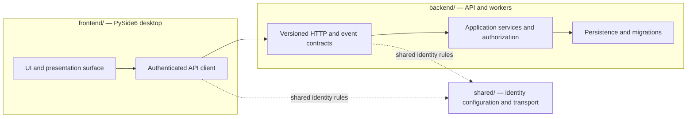

# Architecture and code ownership

Buddy is a native PySide6 desktop application backed by an API; later processing workers
will also belong to the backend. The
desktop and backend are separate installable Python projects. They communicate over the
versioned HTTP/event contracts; neither imports the other's implementation. `buddy_identity`
is a small shared package because the client and API both validate the same Cognito issuer,
client, and bounded identity transport rules. It contains no desktop UI or server behavior.

## Directories

| Path | Ownership |
| --- | --- |
| `frontend/src/buddy_desktop/` | Desktop UI, presenter surface, API client, and local Windows/macOS adapters. |
| `frontend/tests/` | Desktop and Qt tests. |
| `frontend/scripts/` | Desktop startup smoke and packaging/signing helpers. |
| `backend/src/buddy_api/` | API endpoints, application services, authorization, persistence adapters, and future worker entry points. |
| `backend/migrations/` | Alembic environment and immutable database revisions. |
| `backend/tests/` | API, database, and backend tests. |
| `backend/scripts/` | Backend health smoke and deployment helpers. |
| `shared/src/buddy_identity/` | The narrowly scoped identity configuration and transport used by both components. |
| `tests/integration/` | Tests that intentionally exercise multiple components together. |
| `tests/repository/` | Repository tooling, CI, and security-scanner tests. |
| `scripts/` | Repository-wide quality/test runners and GitHub Project automation. |
| `infra/` | Terraform, container definitions, and infrastructure tests. |
| `docs/` | Architecture, setup, feature, security, and operations guides. |
| `.github/workflows/` | CI, security, infrastructure, deployment, release, and Project workflows. |

## Runtime and dependency boundaries

The desktop owns local windows, display/microphone adapters, OS preferences, and its
authenticated API client. It does not connect to the server database, make authorization
decisions, or contain privileged provider credentials. Long-running desktop work runs
outside the Qt GUI thread.

The backend owns HTTP/event contracts, application rules, server-side authorization,
persistence, provider integrations, and worker entry points. It does not import desktop
widgets or local OS adapters. It derives account ownership from verified server-side
identity and enforces it for private resources.

`shared/` stays limited to code that both components must use identically. Add another
shared module only when there is a concrete contract used by both sides; do not move
business logic there. Tests in `tests/integration/` may import both components, but runtime
packages must continue to interact through versioned contracts.

See [development](development.md) for setup and entry points, [API operations](api/README.md)
for backend configuration, and [deployment](deployment.md) for infrastructure and releases.
