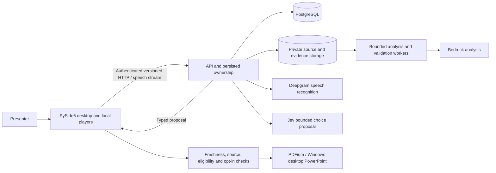

# Buddy: a constrained presentation companion

Technical report for the application-oriented Agentic Systems course.
Evidence baseline and submission status are in the [package index](README.md).

## User, problem and workflow

A presenter must keep a talk and its visual material aligned while speaking, navigating
slides and recovering from interruptions. Buddy provides a native PySide6 workspace
for PDF and supported Windows PowerPoint presentations. Its agent can associate fresh
speech with an eligible slide or saved focus action; manual navigation and recovery
remain available throughout. The intended benefit is less attention spent operating
slides. We have not measured presenter workload or learning outcomes.

The full connected workflow is: sign in, upload an original PDF/PPTX, inspect its
analysis and action evidence, open the exact saved presentation, connect a session,
start the microphone, enable live suggestions and optionally enable automatic moves.
Speech recognition supplies recent text. An intent provider proposes one target or
no action. Buddy validates that proposal against the current session and local view
before a native executor can act. The presenter can pause, override, reset or undo.
The [local demo](reproduce.md) exercises manual controls without those cloud prerequisites.

## Where agency is useful, and where it stops

Contextual statements such as discussing a chart or referring to a topic require
interpretation beyond an exact command grammar. The current Jev path scores a bounded
menu built from the saved analysis: other slides, eligible zoom/highlight actions on
the current slide, reset when applicable and no action. Its separate `presenting_now`
score helps distinguish presenting/requesting from quoted, negated or hypothetical
speech. The implemented default floors are 0.5 for an action and 0.4 for presenting;
they are decision rules, not calibrated accuracy guarantees.

The loop is bounded observation, proposal and guarded execution. It is not an arbitrary
planner with shell access. Explicit next/previous/slide-number commands use a
deterministic fast path. Ownership, source hashes, allowable geometry, eligibility,
freshness, deduplication and execution stay deterministic. Region coordinates come
from saved validated actions, not model output. A model can still choose the wrong
allowed target; allowlisting reduces capability risk without proving intent.

The presenter controls microphone capture, cloud suggestions and automatic transitions
separately. Automatic moves default off. Manual input invalidates pending work; undo
restores the previous view and pauses automatic moves. A failure waits for fresh speech
rather than replaying an obsolete request. See [agent contracts](../presentation-agent.md),
[Jev decisions](../jev-direct-current-prototype.md), [speech context](../transcript-context.md)
and [transition policy](../transition-policy.md).

## Architecture, API and tool boundaries

The desktop and backend are separate installable packages. Their only shared runtime
package contains identity configuration/transport rules. The desktop owns windows,
microphone and native execution; it has no database access or provider keys. The API
owns identity checks, authorization, persisted sessions, provider admission and tool
eligibility. Workers have separate privileges. The API invokes the separately installed
headless validator over versioned JSON without importing Qt. PDF and PowerPoint have
independent action catalogs and source/runtime evidence.

| Interface | Responsibility and limit |
| --- | --- |
| `/health`, `/api/v1/ready` | Liveness versus database/migration readiness; liveness alone proves no authenticated workflow. |
| Owner-scoped deck/upload/analysis routes | Persisted identity and source lineage; private source/evidence delivery. |
| Session speech/events | Authenticated bounded streaming and reconnect; capture/context invalidation. |
| `POST /api/v1/sessions/{id}/agent` | `presentation-agent.v1` request, typed proposal/no-action response, no direct execution. |
| `PUT /api/v1/sessions/{id}/slide-image` | Owner-bound current-slide image for Jev; bounded size and in-memory lifetime. |
| `POST /api/v1/sessions/{id}/transition-check` | Deterministic preflight contract; current desktop avoids the redundant round trip for already checked navigation/focus targets. |
| Local executor | Applies a typed eligible target after local checks; records success only after execution. |

The [architecture map](../architecture.md), [OpenAPI snapshot](../api/openapi.json),
[API guide](../api/README.md), [session events](../session-events.md) and
[saved-action guide](../present-actions.md) are authoritative contracts. Optional web/image
search uses separate constrained routes/providers; it is outside this package's evaluated
slide-action claims. A Jev key selects the current direct-menu path; without it, the
legacy Cohere path remains. The frozen replay below exercises that historical Cohere
adapter contract, not the current live Jev service.

## Evaluation and what it establishes

Fresh baseline replay passes 21/21 frames in each of two authored synthetic partitions,
including abstention and malformed/provider-failure cases. Both report exact target
agreement 1.0, no-action precision/recall 1.0 and zero out-of-menu proposals. Expected
answers and provider responses were authored together; the second partition is not an
independent human holdout. These numbers demonstrate contract preservation, not natural
language understanding. The reports retain `synthetic_contract`, `agent_proposals` and
`release_gate: false`.

Existing provider work reports 87.5% correct over 1,020 synthetic-text sentences and
approximately 244 ms mean Jev decision latency. Native generated-fixture results and
current saved-action evidence are summarized separately in the [evidence ledger](evidence.md).
These experiments have different commits, sample scopes and substitutions; they cannot
be pooled into one accuracy or speed claim. There is no new real-provider, microphone
or Office run in this package. No current repeated speech-to-visible p50/p95, independently
held-out human accuracy, or complete billed cost per successful task is established.

The [reproduction guide](reproduce.md) runs the existing harness and regression tests.
It also explains how to run the app locally, repeat optional native/provider checks,
and retain failures, hashes and provenance. The [demo/poster plan](demo-poster.md) includes
both working controls and a real blocked case rather than depending on a happy path.

## Security, privacy and supported limits

The [#26 threat model](../course-threat-model.md) names private decks, derived assets,
audio/transcripts, credentials, session state and provider budget. Main threats are
cross-account access, malicious files, injected instructions, unsafe/stale actions,
provider failure and private-content leakage. Mitigations include authenticated
ownership, private encrypted storage, bounded parsing/provider input/output, fixed
provider destinations, strict targets and content-free routine telemetry. Privileged
operators, compromised accounts, provider processing and semantic mistakes remain risks.
Tests verify boundaries; they do not certify a live deployment.

Cloud use sends private inputs to providers: Deepgram receives audio, Jev can receive
recent speech and slide text/images, Bedrock receives analysis input, and optional
Cohere/search paths receive their documented text/queries. This is not an on-device
privacy claim or a universal provider-retention guarantee. Recognized speech has a
five-minute reconnect retention window; deliberate raw audio persistence is separate.
Opt-in diagnostic exports can contain content and must remain private.

The built-in PDF path and Windows desktop Office path must be reported separately.
PowerPoint on macOS, headless Linux Office validation, stale sources and unverified
regions cannot be counted as passing native support. The 28 November saved-action run
passed PDF highlight/zoom and 15 native PowerPoint annotation types; PowerPoint zoom
was blocked by Windows foreground restrictions. Historical preflight zoom success on
another Office build does not override that blocked run. Data provenance, historical
timings, failures and final evidence still needed are recorded in the evidence ledger.
