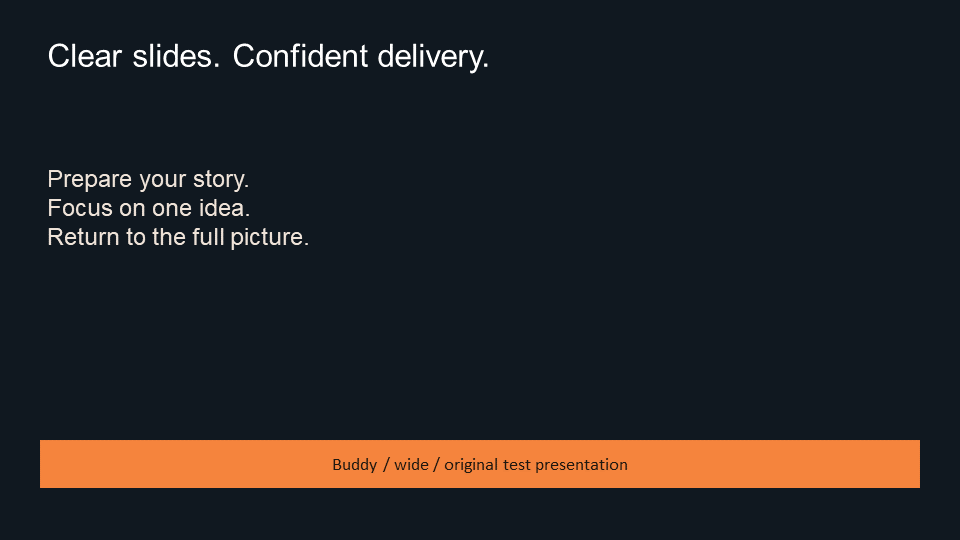
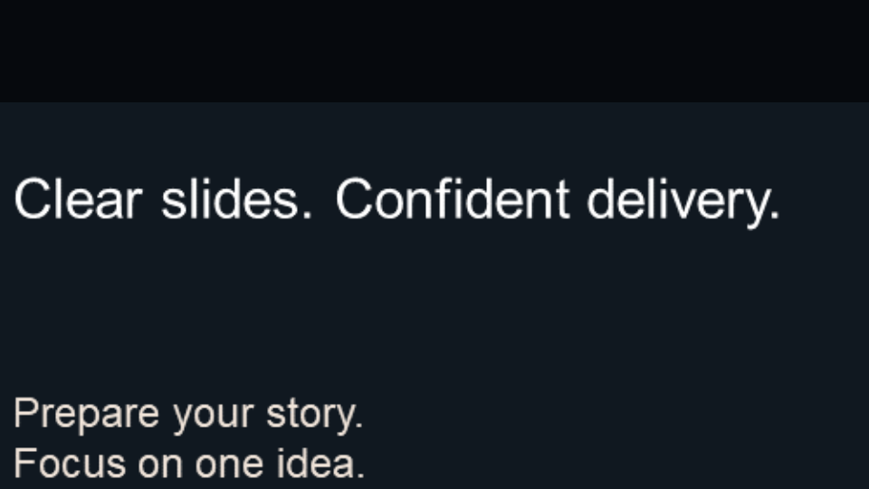
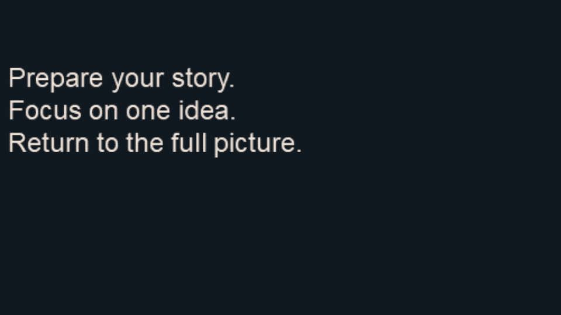
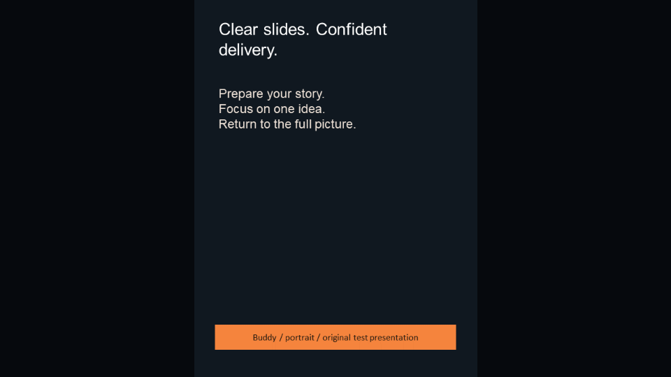
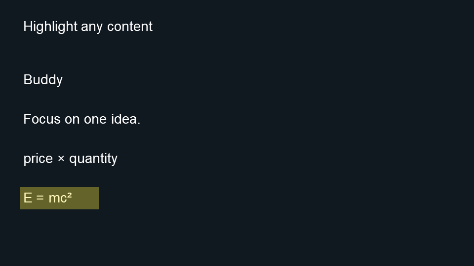

# Slide action catalog v1 / v1.1

Issue #47 provides a reusable production PySide6 executor and raster presentation surface.
It implements `next_slide`, `previous_slide`, `go_to_slide`, `zoom_region`, `reset_view`
and the requester-approved sixth command, `highlight_region`. Buddy's Present workspace
provides local file opening, rectangle selection and buttons for manual testing. It does
not need an account, converter, semantic graph, generated analysis, live session,
microphone, OS automation or model. Library/session wiring remains with
the corresponding later issues. The persisted input is a manifest plus image files;
camera position, selection and highlights are transient local UI state, not new
database/session records. See the [manual test guide](slide-actions-manual.md).

## Standalone contracts

The authoritative JSON Schema 2020-12 files are packaged with the desktop wheel, but
can be read/copied by backend tools **without importing frontend Python or Qt**:

- [Original five-action v1.0 schema](../frontend/src/buddy_desktop/slide_contracts/action-v1.schema.json)
- [Six-action v1.1 schema](../frontend/src/buddy_desktop/slide_contracts/action-v1.1.schema.json)
- [Slide manifest schema](../frontend/src/buddy_desktop/slide_contracts/manifest-v1.schema.json)
- [Golden manifest](../frontend/tests/fixtures/slide_actions/manifest.json),
  [action instances](../frontend/tests/fixtures/slide_actions/actions.json) and
  [coordinate mappings](../frontend/tests/fixtures/slide_actions/mappings.json)

Each schema variant is a reusable **template**. An instance is JSON with `version: "1.0"`
(original five commands) or `version: "1.1"` (all six commands),
`type`, `instance_id`, a nonblank specific `purpose`, `deck_id`, `render_id`, `slide_id`
and `params`. Do not send a schema as an instance. Unknown fields at every level,
unknown types/versions, missing fields and unsupported parameters are rejected.
The frontend validates against these exact packaged schemas; there is no second schema copy.

| Template/type | Required `params` | Result |
| --- | --- | --- |
| `next_slide` | `{}` | Next manifest entry, full view. Last entry stays last, full view. |
| `previous_slide` | `{}` | Previous manifest entry, full view. First stays first, full view. |
| `go_to_slide` | `{"target_slide_id": "opaque-id"}` | Exact matching entry, full view; unknown ID rejected. |
| `zoom_region` | `{"region": {"x": 80, "y": 64, "width": 1760, "height": 200}}` | Contain and center this canonical rectangle. |
| `reset_view` | `{}` | Current full slide, including during an in-flight load. |
| `highlight_region` (v1.1) | `{"region": {"x": 80, "y": 760, "width": 320, "height": 90}}` | Replace the single yellow highlight without changing the camera. |

The v1.0 action and manifest schemas are unchanged. Existing five-command v1.0 inputs
remain valid; v1.0 intentionally rejects highlighting. The manifest version remains `1.0`
for both action versions. [Six-command examples](../frontend/tests/fixtures/slide_actions/actions-v1.1.json)
use the [four-slide manual manifest](../frontend/tests/fixtures/slide_actions/manual-manifest.json).

Highlighting uses the same source rectangle coordinates and bounds as zoom, with no
1/32 minimum size: a word, formula, expression, picture or any other visible content can
be marked. This is a pixel-region overlay, so no text recognition or text-position index
is required. Every valid highlight replaces the previous one; repeating it does not
accumulate opacity. The overlay is `#FFEB3B` with alpha `90/255` (about 35%), SourceOver.
It follows the slide's transform on zoom/resize and does not modify source image files.

Zoom preserves the highlight. Changing to a different slide, loading a new manifest,
pressing Reset, cancellation or a load failure clears it. A navigation boundary or jump
to the already-current slide preserves the highlight because no slide changes. Invalid
commands preserve the existing highlight, camera and image. The six-command catalog does
not introduce a separate clear action; Reset returns to the full slide and clears the mark.

All references are opaque, case-sensitive stable IDs, 1..128 characters with at least one
non-whitespace character. IDs must not be parsed into file paths, order or indices.
`instance_id` correlates a caller's purpose/parameters with completion; it is not an
idempotency key. Repeating valid instances executes again (including navigation).
`slide_id` always means the **expected current slide**, even for navigation. Deck/render
IDs and current slide must match the committed manifest; stale references reject before
loading anything. Regenerating images/order/dimensions must assign a new `render_id`.
Integers used as IDs, numeric indices, booleans, empty targets and invented actions reject.

## Manifest and canonical coordinates

The `slides` array is the only navigation order, with 1..1000 entries and unique
`slide_id`s. Mixed aspect ratios are supported. Every entry specifies:

- `source.width/height`: integer dimensions 1..16384 of the canonical coordinate plane.
  `units: "source_pixels"`, `origin: "top_left"`. X increases right, Y increases down;
  rectangle bounds are continuous edges, not inclusive last-pixel indexes.
- `raster.width/height`: integer PNG dimensions 1..8192, at most 16,777,216 total pixels.
  The source and raster aspect ratios must match **exactly by integer cross-product**.
- `raster.transform: "scale"`: `(raster_x, raster_y) =
  (source_x * raster_width / source_width, source_y * raster_height / source_height)`.
  No crop, rotation, EXIF orientation, padding, mirroring or hidden transform is accepted.
  Producers must bake those into the pixels and provide matching source coordinates.
- `raster.path`: relative portable PNG path beneath the manifest directory, with slash-separated
  ASCII alphanumeric/underscore/hyphen segments; no URLs, drive letters, backslashes,
  dot segments or absolute paths. Resolved symlinks must remain beneath that directory.
- `raster.sha256`: lowercase hex digest of the exact file bytes. A mismatched digest,
  PNG header size or failed decode fails the operation before surface mutation.

Schemas enforce structural constraints. Consumers must additionally enforce finite numbers,
unique IDs, matching aspect ratios, total pixel bounds, current/deck/render/target references,
rectangle bounds, path containment and image digests/dimensions. JSON Schema cannot express
these cross-record checks; implement them before generating/converting/executing instances.
JSON ingress must reject duplicate fields, NaN/infinities and excessive input structure.
`read_json` caps files at 2 MiB; parsed inputs are limited to 12 levels, 50,000 values,
16 properties per object and 1000 array elements. Action strings are bounded by the schema.
PNG reads cap compressed bytes at 64 MiB. Only one image is decoded at a time; the previous
committed image remains available. No whole-deck raster preload or unbounded action queue.

Zoom rectangles require finite nonnegative X/Y, positive width/height, and
`x + width <= source.width`, `y + height <= source.height`. Each rectangle dimension
must be at least 1/32 of the corresponding source dimension (at most 32x relative
magnification). Full-slide rectangles and fractional coordinates within these limits
are valid. Invalid regions reject; they are not silently clipped or normalized.

For region `(x,y,w,h)` and viewport **logical** dimensions `(W,H)`:

```text
s = min(W/w, H/h)
ox = (W - w*s)/2 - x*s
oy = (H - h*s)/2 - y*s
logical(X,Y) = (ox + X*s, oy + Y*s)
device(X,Y) = DPR * logical(X,Y)
```

Qt paints in logical pixels and applies DPR once. Fractional transforms remain floating
point until rasterization; device edges need not land at integers. Full-slide rendering
letterboxes with `#06090D`. Zoom preserves the complete requested rectangle and may show
neighboring slide content where the viewport aspect differs. Pixels beyond the slide are
background. Resizing retains the canonical rectangle and recomputes the mapping; there
is no cumulative zoom error. [Golden mappings](../frontend/tests/fixtures/slide_actions/mappings.json)
include source-to-raster scale 0.5, letterboxing, portrait, and DPR 1/1.5/2 cases.

## Executor lifecycle and completion

Create `SlideSurface` and its `SlideExecutor` on the QApplication thread. Call
`load_manifest(Path(...))`, then send decoded instances through **only** `dispatch(value)`.
Both return a local monotonically increasing request ID. Connect `completed` **before**
calling: validation, cached zoom/reset and boundary navigation may complete synchronously.
`Completion` contains request ID, validated instance ID when available, status, safe error
message and committed slide ID. It is an immutable snapshot. `surface.region`, `surface.highlight`, `surface.slide`
and `executor.current_index` expose committed state for later validation.

There is no animation or duration parameter in v1/v1.1: cached operations commit immediately;
disk reads, hashing and QImage decoding run in a single worker. The signal marks committed
state and a scheduled repaint; it does not promise physical display scanout. To inspect
rendered pixels, render/grab the widget after completion. Long IO never blocks the GUI thread.
`busy` remains true until the worker callback is drained; `idle` signals capacity to load again.
No queued action backlog is accepted.

| Situation | Terminal status and settled state |
| --- | --- |
| Valid action/load | `completed`; requested slide/rectangle committed atomically. |
| Malformed/stale/unsupported action, busy/closed request | `rejected`; committed image/camera unchanged. |
| Missing/corrupt/mismatched image or invalid manifest | `failed`; previous committed deck/slide restored to full view. If nothing loaded, empty dark surface. |
| `cancel()` or reset while loading | In-flight request `cancelled` exactly once; previous full slide retained; late result discarded. Reset has its own `completed` result. |
| First/last boundary or same-slide jump | `completed`; same slide, full view. |

`cancel()` and `close()` are lifecycle controls, not additional action types. Cancellation
invalidates a result immediately but does not interrupt a native file read/decode mid-call.
Further loads wait for `idle`; cached reset remains available. `close()` rejects further
requests and discards pending results. Keep the surface/executor alive until `idle`, and
call `wait_for_shutdown()` after the event loop exits before destruction. Never wait on
the worker from an interactive GUI callback. Calls from another thread raise `RuntimeError`
before touching Qt state. Later consumers should marshal calls using queued Qt delivery.

## Real-surface evidence and verification

The checked-in [fixture provenance](../frontend/tests/fixtures/slide_actions/README.md)
includes original PPTX files and actual PowerPoint exports. No external sample decks are
redistributed. Tests compare complete full-slide/title/body viewport pixel arrays with
the original exports/crops, exercise native grabs, different aspect ratios, window sizes,
DPR 1/1.5/2, retries, boundaries, malformed inputs, stale references and in-flight cancellation.

Reproduce the published before/after evidence from the repository root:

```sh
python frontend/scripts/capture_slide_actions.py --manifest frontend/tests/fixtures/slide_actions/manifest.json --actions frontend/tests/fixtures/slide_actions/actions.json --output build/slide-actions-evidence
python -m pytest frontend/tests/test_slide_actions.py
```

Set `QT_QPA_PLATFORM=offscreen` on macOS/headless systems; Windows tests use native Qt.
Add `--width 800 --height 600 --dpr 2` to inspect another viewport/device ratio.
The script imports the real production executor/surface, replays only the allowed catalog
types, and records each input plus committed rectangle/ID and a PNG of the actual widget.

| Step | Instance parameters | Before → after |
| --- | --- | --- |
| 0 | Manifest load | Empty → wide slide, full `(0,0,1920,1080)` |
| 1 | Title `(80,64,1000,200)` | Wide full → wide title region |
| 2 | Body `(80,320,1000,360)` | Title → body region (absolute, not cumulative) |
| 3 | Reset `{}` | Body → wide full |
| 4 | Next `{}` | Wide → standard full `(0,0,1440,1080)` |
| 5 | Previous `{}` | Standard → wide full |
| 6 | Jump target `slide:portrait/opaque` | Wide → portrait full `(0,0,1080,1440)` |
| 7 | Reset `{}` | Portrait full → portrait full |

See [captured states and parameters](evidence/slide-actions-v1/evidence.json):






The captures show centered contain behavior at 960x540 logical pixels, DPR 1. They are
review evidence, not a platform-specific font baseline: tests compare the already-rendered
PNG pixels and allow small interpolation differences only for fractional-device scaling.

The [v1.1 evidence](evidence/slide-actions-v1.1/evidence.json) additionally records each
highlight rectangle and its rendered pixels for the real word, phrase, expression and
formula slide, followed by Reset. Reproduce it with:

```sh
python frontend/scripts/capture_slide_actions.py --manifest frontend/tests/fixtures/slide_actions/manual-manifest.json --actions frontend/tests/fixtures/slide_actions/actions-v1.1.json --output build/slide-actions-v1.1-evidence
```


